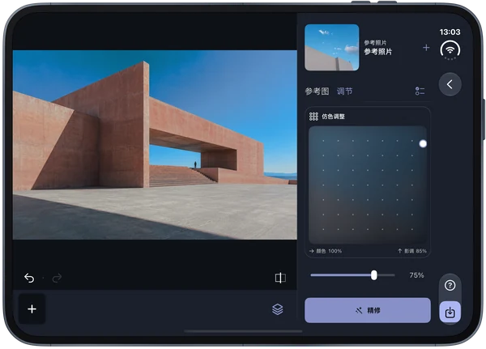

# Awaking 官网

**把照片，调成你的表达。**

Awaking 是面向 iPhone 和 iPad 的照片编辑器。借鉴参考照片的色彩与影调，按自己的照片调整强度，再用蒙版、画笔和图层精修。照片编辑在设备上完成。

[中文官网](https://awakingapp.com/awaking/zh/) · [英文官网](https://awakingapp.com/awaking/en/) · [在 App Store 查看](https://apps.apple.com/app/id6760924133)


## 从一张照片开始

这个例子用泳池与建筑的青绿色，为海岸照片寻找配色方向。对照原图与实际导出的 JPEG，可以看到海水和沙地的色彩变化。指南也演示怎样选择参考、调整强度，以及如何判断哪些细节值得继续精修。

| 海岸原图 | Awaking 实际导出 |
| --- | --- |
|  |  |

展开 iPhone Duo 后，横向界面把照片和编辑工具并排呈现。竖向展开时，调整区移到底部，手上的编辑可以接着做。



[仿色案例与原图对比](https://awakingapp.com/awaking/zh/guides/reference-color-matching/#case) · [用蒙版调整照片的一部分](https://awakingapp.com/awaking/zh/guides/local-photo-adjustments/)

## 官网入口

| 页面 | 简体中文 | English |
| --- | --- | --- |
| 官网 | [首页](https://awakingapp.com/awaking/zh/) | [Home](https://awakingapp.com/awaking/en/) |
| 技术支持 | [权限、导出与购买问题](https://awakingapp.com/awaking/zh/support.html) | [Technical Support](https://awakingapp.com/awaking/en/support.html) |
| 隐私政策 | [隐私政策](https://awakingapp.com/awaking/zh/privacy-policy.html) | [Privacy Policy](https://awakingapp.com/awaking/en/privacy-policy.html) |
| 用户协议 | [用户协议](https://awakingapp.com/awaking/zh/terms-of-service.html) | [Terms of Service](https://awakingapp.com/awaking/en/terms-of-service.html) |

根入口按浏览器语言进入 Awaking，页面内可切换中英文。旧版 App 里的根级地址继续提供 Awaking 1.0 的历史资料和现行页面入口。[1.0 技术支持](support.html) · [1.0 隐私政策](privacy-policy.html) · [1.0 用户协议](terms-of-service.html)

## 本地维护

- `awaking/zh/` 和 `awaking/en/` 各自维护首页、指南、支持、隐私和协议。语言切换应落到同一内容的译版。
- `awaking/shared/` 存放共用样式与脚本。照片、真实界面与设备外框的出处见 [素材清单](awaking/assets/site-v4/responsive/manifest.json)。
- `awaking/sitemap.xml` 列出 Awaking 的正式页面。新增页面时同步核对正式网址、语言替代链接、站内跳转和公开图片。

在仓库根目录运行以下命令，然后打开本地的 [中文首页](http://127.0.0.1:8765/awaking/zh/) 或 [英文首页](http://127.0.0.1:8765/awaking/en/)。

```bash
python3 -m http.server 8765 --bind 127.0.0.1
```

```bash
node --test tests/*.test.cjs
git diff --check
```

提交前检查双语链接、指南锚点、窄屏和短窗口下的操作区，以及键盘能否操作菜单与照片对比。视觉与证据边界见 [官网设计说明](DESIGN.md)。[产品说明](PRODUCT.md) · [既往视觉验收](design-qa.md)

GitHub Pages 从 `master` 分支的仓库根目录发布。维护者推送后，核对公开的中英文首页、支持、隐私、协议及旧链接，再同步 App Store Connect 的公开链接。
