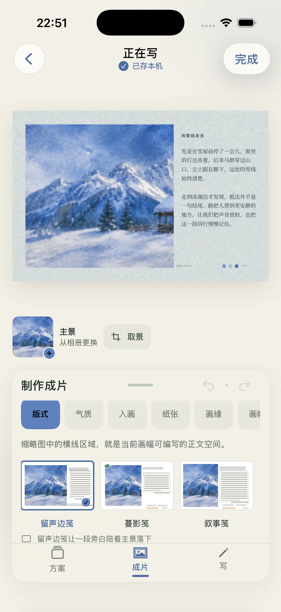
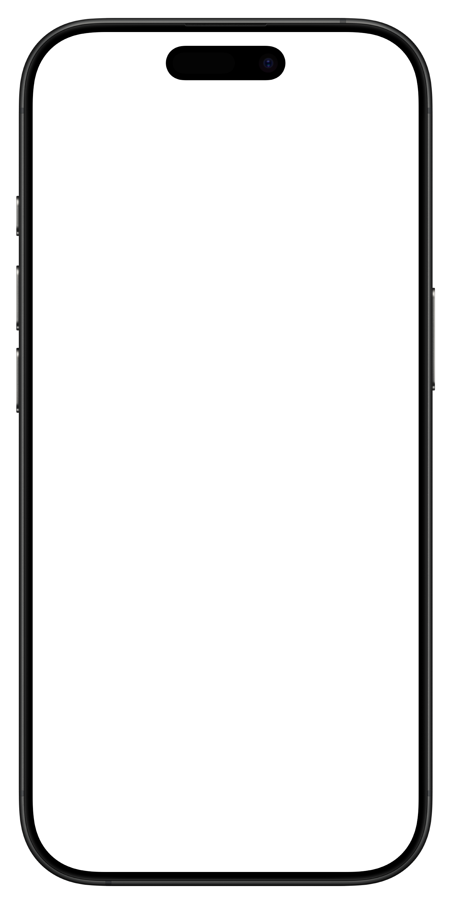

# 片笺双语官网组件

作者 Condy，更新于 2026-11-10。

## 页面与设计方案

中文入口为 `index.html`，英文入口为 `index-en.html`。两个页面共用 `home.css` 与 `home.js`，以浅雾绿首屏、三台手机展示、二楼小相机、五项功能导览、亲笔介绍、常见问题和下载区组织内容。导览顺序为版式、纸张、画面、文字、亲笔，对应 Layout、Paper、Image、Words、Handwriting。

官网统一称“片笺小相机 / Postcard Camera”。“胶片”用于描述可选的画面气质。灵动岛只在支持该顶部形态的 iPhone 展开说明中出现，iPhone 与 iPad 的共同进入方式写为首页到顶后继续下拉。该命名与文案经过专业文案 Agent 审阅，并由当前相机合同核对。

2026-11-10 文案复核进一步收紧首页、相机、纸张、画面与书写说明。英文相机标题使用 “One floor up” 呼应首页二楼，具体手势放在操作步骤中。完整名称增加导航宽度，桌面导航收起阈值调整为 1020px。本批次完成静态 HTML、锚点、CSS 与聚焦测试检查；浏览器工具拒绝打开 `file://` 页面，当前文字换行仍待实际浏览器复核。

首页使用独立样式，品牌颜色、字体和间距由 `home.css` 的根变量维护。系统无衬线字体承担正文与导航，宋体或 Georgia 用于品牌与重点语句。页面根据 1020、720、480 像素三个断点降级，导航在 1020px 及以下使用菜单，移动端首屏保留一台主要手机。

所有下载入口按页面语言静态路由。中文页的桌面导航、移动菜单、首屏和底部按钮全部进入中国大陆 App Store（`/cn/app/`），英文页的四处入口全部进入美国 App Store（`/us/app/`），App ID 统一为 `6799028972`。中文目标地址已用 Apple 官方查询接口核对。

## 二楼小相机与下载区

相机区位于首屏后，以墨绿背景展示“首页到顶后继续下拉、拍下并等待显影、从本机橱窗保存或继续制作片笺”这条路径。首屏次按钮与导航都能直达，区内链接继续进入创作导览。内容按片笺当前相机合同核对。

桌面端采用左侧说明、右侧相机画面。720px 及以下依次显示标题与简介、相机画面、三步说明，让画面尽早进入可见区域。`.camera-capture` 复用图片加载与重试组件。双语相机素材均使用普通 iPhone 的 1206 × 2622 截图，共用外壳、屏幕开口定位与展示尺寸。

相机素材沿用已有 20-debug 营销截图，经 WebP q88 转码，保留原始尺寸和完整内容。来源与哈希见 `assets/provenance.json`，对外发布前仍需与最终相机版本核对。

下载区使用当前 App Icon 的 512 × 512 WebP 展示图，配文为双语品牌名称。使用 `height: auto` 与正方形比例，桌面图宽上限 190px，630px 窗口为 150px，480px 及以下为 140px。图像来源与哈希记录在素材清单中。

## 手机展示组件

`phone` 使用用户提供的 1406 × 2822 透明 PNG 外壳，截图与外壳分别加载。屏幕开口为 1206 × 2622，左边距 102 像素、上边距 100 像素。CSS 使用百分比保持等比对齐。截图完整显示。

### 属性约定

| 属性 | 必需 | 定义 |
| --- | --- | --- |
| `data-phone` | 是 | 启用独立的加载与失败状态 |
| `data-loading-label` | 是 | 当前页面语言的加载说明 |
| `data-error-label` | 是 | 当前页面语言的失败说明 |
| `data-retry-label` | 是 | 当前页面语言的重试按钮名称 |
| `--phone-width` | 否 | 组件宽度，默认 280px，并受父容器宽度约束 |
| `.phone-image` 的 `src` 与 `alt` | 是 | 截图路径及有意义的替代文本 |
| `.phone-image` 的 `loading` | 否 | 首屏用 `eager`，其余用 `lazy` |
| `.phone-shell` 的 `src` | 使用设备外壳时 | 外壳路径，装饰图片使用空 `alt` |

### 使用示例

```html
<figure class="phone" style="--phone-width: 300px"
        data-phone data-loading-label="正在加载画面"
        data-error-label="这张画面暂时无法加载"
        data-retry-label="重新加载">
  <div class="phone-screen">
    
  </div>
  
</figure>
```

组件内部状态为 `loading`、`ready`、`error`。脚本先注册加载事件，再读取缓存状态。失败时保留尺寸并提供同源重试，正常加载不逐项播报。外壳失败时降级为截图展示。JavaScript 不可用时仍展示原始图片。

## 功能导览组件

### 属性约定

| 属性 | 必需 | 定义 |
| --- | --- | --- |
| `data-tour` | 是 | 一组独立的导览状态与面板范围 |
| `data-tour-tabs` | 是 | 控件容器，初始使用 `hidden` |
| 控件容器的 `aria-label` | 是 | 当前页面语言的导览名称 |
| `data-tour-tab` | 是 | 使用原生 `button type="button"` |
| 按钮的 `id` | 是 | 全页唯一，用于面板无障碍关联 |
| 按钮的 `aria-controls` | 是 | 当前导览容器内面板的唯一 ID |

### 使用示例

```html
<div class="tour" data-tour>
  <div class="tour-tabs" data-tour-tabs aria-label="选择创作功能" hidden>
    <button class="tour-tab" type="button" id="example-tab"
            data-tour-tab aria-controls="example-panel">版式</button>
  </div>
  <section class="tour-panel" id="example-panel" aria-labelledby="example-title">
    <div class="tour-copy"><h3 id="example-title">给照片一页纸。</h3></div>
    <div class="tour-media"><!-- 放入手机展示组件 --></div>
  </section>
</div>
```

初始化验证所有面板归属后，脚本添加 `tablist`、`tab`、`tabpanel` 语义并选中第一项。点击和方向键切换当前组，Home 与 End 跳到首尾，Tab 按浏览器常规顺序移动。一个按钮进入 Tab 顺序，其他按钮使用方向键抵达。键盘切换会将选中标签滚入可见区域，标签的横向滚动留白保护焦点轮廓。

缺少或错误的面板引用会保留静态内容。无 JavaScript 时控件保持隐藏，所有内容按顺序展示。手机屏幕已声明固有尺寸，避免资源加载改变布局。动画只影响透明度与位移，系统启用减少动态效果时停用。

## 常见问题与移动菜单

两者使用原生 `details` 与 `summary`，支持键盘并在 JavaScript 不可用时工作。移动菜单在点击链接或外部区域后关闭，Escape 关闭并把焦点交回触发器。

## 验证与边界

从官网仓库执行聚焦检查。

```sh
node --check pianjian/home.js
node --test tests/postcard-home.test.cjs
git diff --check
```

静态检查覆盖本地链接、锚点、HTML 结构、CSS 语法、双语组件关联与截图尺寸，10 项聚焦组件与下载路由测试通过。

2026-11-10 经用户明确授权完成本地浏览器验收。

| 页面语言 | 320px | 390px | 768px | 1440px |
| --- | --- | --- | --- | --- |
| 简体中文 | 通过 | 通过 | 通过 | 通过 |
| 英文 | 通过 | 通过 | 通过 | 通过 |

四档窗口均满足页面滚动宽度等于视口宽度，标题与主动作可读，手机外壳与截图保持等比。桌面展示三台手机，窄屏展示一台主要手机。

运行态确认了导览点击、Home/End 与方向键的选中项及焦点、移动菜单 Escape 关闭与焦点恢复、中英切换、原生问答展开、减少动态效果下停用动画。使用临时请求阻断触发本地截图加载失败，解除阻断后点击重试可恢复展示。

验收修正了两项问题。

- 中文导览标题在 320px 下出现孤立末字，收短为“从一张照片，写成一张片笺”。
- 英文导览最后一项在键盘选择后部分超出滚动区，增加滚入可见区域处理与焦点留白。

本地证据位于工作区 `outputs/website/postcard-20261110/`，包含最终双语尺寸矩阵、桌面和窄屏截图以及失败状态截图。截图为本地浏览器证据，VoiceOver 实际朗读、Safari 与实体设备仍待验证。

同日完成二楼相机与未未比例的追加复测。双语页面在 320、390、630、768、1440px 五档窗口均无横向溢出，未未图片宽高比均为 1，相机截图的渲染比例与各自源图一致。630px 下未未为 150 × 150px，首屏到相机、相机到创作导览的锚点导航通过。追加证据保存在上述目录的 `camera-weiwei/` 中。

按后续页面反馈，中文相机截图补齐 iPhone 外壳，下载区双语图片改用当前 App Icon 的 512px 展示图。中文相机在 1508 × 774、630px 与 320px 窗口下保持屏幕开口和截图比例一致。下载区图标分别以 190 × 190、150 × 150、140 × 140px 展示，英文 630px 下的图标和品牌名称复测通过。证据保存在上述目录的 `shell-icon/` 中。

后续统一英文普通 iPhone 相机截图及设备框，双语相机宽度共用桌面 300px、窄屏 265px。导览加入独立的“纸张 / Paper”面板和各自语言的 1206 × 2622 截图，复用既有加载与键盘交互。双语 320、630、1508px 下无页面横向溢出，五项标签的方向键与首尾键切换通过，320px 下最后一项完整进入可见区。页面中的四处下载链接分别全部匹配 cn 或 us。证据保存在上述目录的 `paper-camera-download/` 中。

本轮调用包括本地页面导航、视口设置、截图、键盘与点击，以及用于减少动态效果和模拟图片失败的浏览器调试接口。临时浏览器设置已恢复，本地静态服务器已停止。工具无法取得精确计量。

网站素材来源记录保存在 `assets/provenance.json`。截图沿用已存在的营销素材，部分为历史 UI，未绑定当前审核 Build。手机外壳按用户提供文件原样复制。

本轮 Knowledge Vault Impact 为 skip。组件合同保存在官网 owner 内，不重复进入产品或共享能力知识库。
